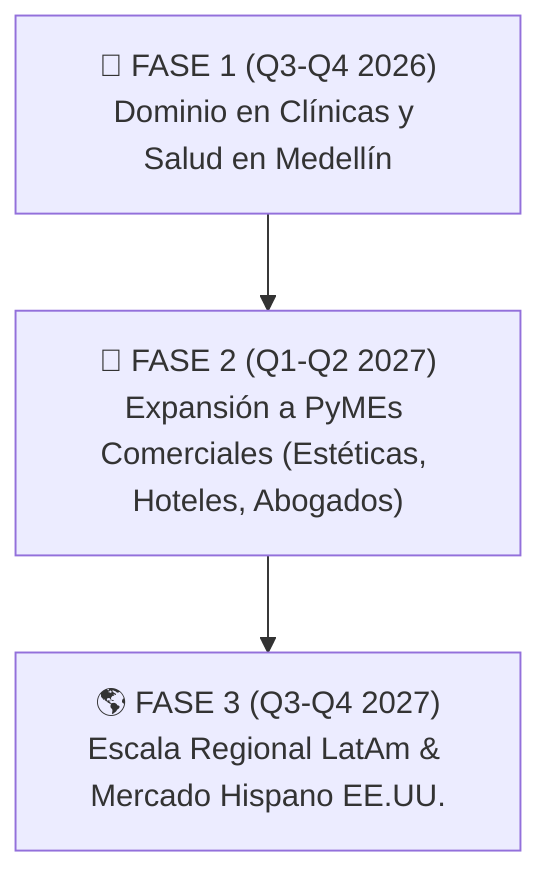

# 🌐 FIRBY AI — DOSSIER EJECUTIVO & SISTEMA OPERATIVO DE NEGOCIOS (2026+)
> *"El fin de los chatbots de juguete. El nacimiento de la fuerza laboral digital autónoma."*

---

```
  ██████╗ ██╗   ██╗██████╗ ██╗     ███████╗███████╗
  ██╔══██╗██║   ██║██╔══██╗██║     ██╔════╝██╔════╝
  ██████╔╝██║   ██║██████╔╝██║     █████╗  █████╗
  ██╔══██╗██║   ██║██╔══██╗██║     ██╔══╝  ██╔══╝
  ██████╔╝╚██████╔╝██████╔╝███████╗███████╗███████╗
  ╚═════╝  ╚═════╝ ╚═════╝ ╚══════╝╚══════╝╚══════╝
       A U T O N O M O U S   B U S I N E S S   O S
```

---

## 💎 1. IDENTIDAD DE MARCA & MANIFIESTO

### ¿Quiénes Somos?
**Firby** es la primera plataforma en Latinoamérica que reemplaza la atención manual y los chatbots tradicionales por **Empleados Digitales Autónomos con Capacidad de Acción**.

No enviamos respuestas automáticas con menús numéricos. **Firby atiende llamadas telefónicas en vivo con voz humana indistinguible, responde WhatsApp en lenguaje natural, consulta calendarios, maneja objeciones de ventas, cobra anticipos por pasarela de pago y crea automatizaciones operativas**.

### 🎯 Nuestro Manifiesto:
1. **Cero Bots de Menú**: Si el cliente siente que está hablando con una máquina, fallamos. Nuestras interacciones tienen pausas humanas, modismos locales, empatía y cero signos robóticos (`¿` o `¡`).
2. **Acción sobre Palabras**: Un asistente que solo habla es un gasto. Un empleado digital que agenda, cobra y da seguimiento es una **máquina de generar ingresos**.
3. **Control Absoluto para el Dueño**: El dueño del negocio no necesita aprender código ni comandos técnicos. Habla con Firby por WhatsApp como hablaría con su gerente de operaciones.
4. **Disponibilidad Total 24/7/365**: Ni un solo lead perdido por estar fuera de horario de oficina.

---

## ⚠️ 2. EL PROBLEMA REAL DEL MERCADO

| La Trampa de la Atención Tradicional | El Fracaso de los Chatbots Genéricos |
| :--- | :--- |
| 💸 **Altos Costos de Nómina**: $1.8M a $3.5M COP/mes por persona + cargas prestacionales. | 🤖 **Experiencia Frustrante**: Menús de *"Marca 1 para citas, 2 para precios"*. |
| ⏰ **Turnos Limitados**: El 45% de los leads escriben después de las 7:00 PM o domingos y se van a la competencia. | 🚫 **Sin Capacidad de Acción**: No pueden consultar agendas reales ni cobrar dinero. |
| 📉 **Falta de Seguimiento**: El 60% de las cotizaciones mueren porque nadie volvió a escribirle al prospecto. | 📞 **Sin Voz Telefónica**: Solo texto; las llamadas quedan desatendidas. |
| 🚫 **Ausentismo en Citas (No-shows)**: Clínicas pierden 25% a 40% de ingresos por pacientes que olvidan su cita. | 🔒 **Alucinaciones Peligrosas**: Respuestas inventadas que dañan la reputación de la clínica. |

---

## 👥 3. LA FUERZA LABORAL DIGITAL FIRBY (LOS 5 EMPLEADOS)

El cliente no compra "un bot"; contrata un **equipo digital coordinado** que comparte la misma memoria y base de datos:

```
┌─────────────────────────────────────────────────────────────────────────────┐
│                          🏢 EQUIPO DIGITAL FIRBY                           │
├─────────────────┬─────────────────┬─────────────────┬───────────────────────┤
│ 👩‍⚕️ VALERIA     │ 💼 SANTIAGO     │ 🎧 CAMILA       │ ⚙️ NOVA & 📢 MATEO   │
│ Recepción & Voz │ Ventas & Pagos  │ Soporte/Triaje  │ Automatización/Growth │
└─────────────────┴─────────────────┴─────────────────┴───────────────────────┘
```

### 👩‍⚕️ 1. Valeria — Recepcionista Ejecutiva & Front-Desk
* **Canales**: WhatsApp + Telefonía en Vivo (ElevenLabs Flash v2.5 / Deepgram Nova-3).
* **Misión**: Convertir llamadas y mensajes entrantes en citas confirmadas en el calendario.
* **Superpoderes**:
  * Contesta llamadas telefónicas con voz cálida y acento local sin retraso perceptible (<400ms).
  * Consulta en vivo espacios libres en Google Calendar.
  * Dispara la **Cadencia Anti-No-Show**:
    * **24h antes**: Confirmación con requisitos y preparación médica.
    * **2h antes**: Recordatorio final con botón de ubicación a Google Maps.
    * **24h después**: Encuesta de satisfacción y seguimiento.

### 💼 2. Santiago — Closer de Ventas & Recaudador
* **Canales**: WhatsApp.
* **Misión**: Convertir preguntas de precio en transferencias bancarias.
* **Superpoderes**:
  * **Matriz de Cierre Psicológico**: Manejo experto de objeciones de precio, tiempo y confianza.
  * **Generador de Links de Pago**: Crea links de **Wompi (Bancolombia, Nequi, PSE, Tarjetas)** y **Stripe** para cobrar anticipos de reserva.
  * **Recuperador de Leads Fríos**: Escribe automáticamente a las 4h y 24h a prospectos que dejaron de contestar.

### 🎧 3. Camila — Especialista en Soporte & Triaje Clínico
* **Canales**: WhatsApp.
* **Misión**: Resolver dudas complejas de procedimientos y proteger la vida de los pacientes.
* **Superpoderes**:
  * Lee y consulta PDFs de consentimientos, catálogos y preparaciones quirúrgicas.
  * **Protocolo de Código Rojo**: Si detecta dolor extremo, hemorragia o fiebre post-operatoria, activa primeros auxilios y **envía una alerta sonada al Telegram del doctor en <2 segundos**.

### ⚙️ 4. Nova — Arquitecto de Automatizaciones
* **Canales**: WhatsApp / Panel Web.
* **Misión**: Conectar el negocio con el resto de sus herramientas mediante lenguaje natural.
* **Superpoderes**:
  * El dueño le pide en español: *"Cada vez que alguien pague, guárdalo en Google Sheets y avísame por correo"* ➔ Nova construye y activa el flujo en **n8n** automáticamente.

### 📢 5. Mateo — Director de Growth & Reactivación
* **Canales**: WhatsApp Saliente Seguro.
* **Misión**: Mantener la agenda llena en días flojos.
* **Superpoderes**:
  * Identifica pacientes que llevan más de 60/90 días sin volver.
  * Envía mensajes hiperpersonalizados con pausas de seguridad de 2 a 3 minutos para **cero riesgo de baneo en WhatsApp**.

---

## 💰 4. PLANES DE MEMBRESÍA & SUSCRIPCIÓN SAAS

Nuestros planes están estructurados para que el retorno de inversión (ROI) sea evidente en la primera semana:

| Característica / Módulo | 📦 PLAN STARTER | 🚀 PLAN PRO (Más Vendido) | 👑 PLAN ENTERPRISE |
| :--- | :---: | :---: | :---: |
| **Enfoque** | Recepción WhatsApp | Recepción + Ventas + Llamadas | Sistema Operativo Total |
| **Precio Mensual (Colombia)** | **$299.000 COP** | **$690.000 COP** | **$1.490.000 COP** |
| **Precio Mensual (Internacional)** | **$75 USD** | **$175 USD** | **$375 USD** |
| **Atención WhatsApp 24/7** | ✅ Ilimitada | ✅ Ilimitada | ✅ Ilimitada |
| **Agendamiento Google Calendar** | ✅ Incluido | ✅ Incluido | ✅ Incluido |
| **Recordatorios Automáticos (24h, 2h)** | ✅ Incluido | ✅ Incluido | ✅ Incluido |
| **Seguimiento Post-Atención** | ✅ Incluido | ✅ Incluido | ✅ Incluido |
| **Recepcionista Telefónica en Vivo (Vapi)** | ❌ No | ✅ **Incluido (Línea Local)** | ✅ **Incluido (Línea VIP)** |
| **Closer de Ventas & Manejo de Objeciones** | ❌ No | ✅ **Incluido** | ✅ **Incluido** |
| **Links de Pago (Wompi PSE / Nequi / Stripe)** | ❌ No | ✅ **Incluido** | ✅ **Incluido** |
| **Soporte con Documentos PDF de la Clínica** | ❌ No | ✅ **Hasta 5 PDFs** | ✅ **Ilimitados** |
| **Triaje de Urgencias & Código Rojo a Telegram** | ❌ No | ✅ **Incluido** | ✅ **Incluido** |
| **Creador de Automatizaciones por Chat (n8n)** | ❌ No | ❌ No | ✅ **Incluido** |
| **Campañas Proactivas de Reactivación** | ❌ No | ❌ No | ✅ **Incluido** |
| **Panel Web & Dashboard con Métricas ROI** | Básico | Completo | Avanzado + Multi-sede |
| **Soporte & Acompañamiento** | Estándar (Email) | Prioritario (WhatsApp) | VIP Dedicado 24/7 |

> 💡 **Equivalencia de Costo**: El Plan Pro cuesta **menos del 25% del salario mínimo de un empleado**, pero trabaja 720 horas al mes sin descansos ni incapacidades.

---

## 🛡️ 5. CICLO DE VIDA DE MEMBRESÍA & POLÍTICA DE RETENCIÓN

```
  [ REGISTRO ] ──▶ [ TRIAL 7 DÍAS ] ──▶ [ ACTIVO (PAGO MENSUAL) ]
                                                │
                                                ▼ (Día 30)
                                      [ PERIODO DE GRACIA (3 Días) ]
                                                │
                                                ▼ (Sin Pago)
                                      [ SERVICIO PAUSADO (Datos Seguros) ]
```

1. **Trial de 7 Días**: El cliente prueba la recepcionista y llamadas gratis para validar el valor.
2. **Renovación Automática**: Facturación mensual recurrente por Wompi o Stripe.
3. **Período de Gracia Amigable**: Si la tarjeta falla o vence el mes, Firby mantiene el servicio activo durante 3 días y le avisa cordialmente al dueño por WhatsApp con el link de renovación.
4. **Modo Pausa Seguro**: Si no se renueva, la base de datos de pacientes, configuraciones y citas **jamás se eliminan**; el bot queda en espera hasta que el dueño decida reactivarlo.

---

## 🗣️ 6. EXPERIENCIA CONVERSACIONAL DEL DUEÑO (CERO COMANDOS)

El administrador interactúa con Firby a través de WhatsApp como con su asistente de confianza:

```
[Dueño]: "Hola Valeria, ¿cómo va el día hoy?"
[Valeria]: "Hola Doctor! Todo excelente. Hoy hemos atendido a 18 personas,
            tenemos 4 citas agendadas y se han recaudado $350.000 en abonos por Wompi.
            Todas las líneas operando al 100%."

[Dueño]: "Oye, créame un flujo: cada vez que alguien pague una cita, mándale
          la factura por correo y anótalo en Google Sheets."
[Nova]:   "Listo Doctor! Ya dejé configurada y activa esa automatización en el
          sistema. Cada vez que entre un pago por Wompi se ejecutará en automático."

[Dueño]: "Mándale un mensaje a los pacientes que no vienen hace 3 meses."
[Mateo]:  "Entendido! Encontré 14 pacientes inactivos. Inicié la campaña de
          reactivación segura con pausas de 2 minutos para cuidar tu número de WhatsApp."
```

---

## 🗺️ 7. ROADMAP ESTRATÉGICO 2026 - 2027



* **Fase 1 (Actual)**: Consolidación en Medellín y Colombia para clínicas odontológicas, estéticas y consultorios médicos.
* **Fase 2**: Apertura del autoservicio para inmobiliarias, firmas de abogados, centros de belleza y academias.
* **Fase 3**: Despliegue en México, Chile, Perú y mercado de clínicas hispanas en Florida/Texas (EE.UU.).

---

## 📞 CONTACTO INSTITUCIONAL & ACCESO

* **Sitio Web Oficial**: [https://firbyai.lat](https://firbyai.lat)
* **Especificación Técnica Completa**: [https://firbyai.lat/master-spec](https://firbyai.lat/master-spec)
* **Documento en Google Drive**: [Abrir en Google Docs](https://docs.google.com/document/d/1_1ZLBQMSuEwRS4fH5tAmgVfKg2OiRZ0W7Lb3kgG52_A/edit)
* **Línea de Demostración Telefónica**: `+1 (279) 213-9140`
* **Línea de WhatsApp Demostración**: `+57 (324) 369-9856`
