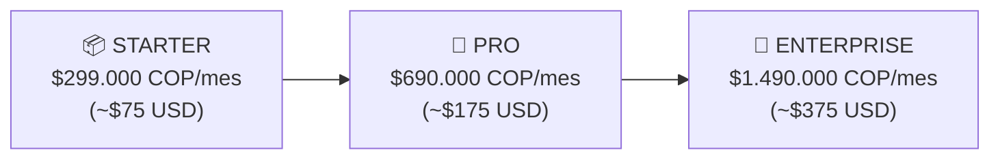
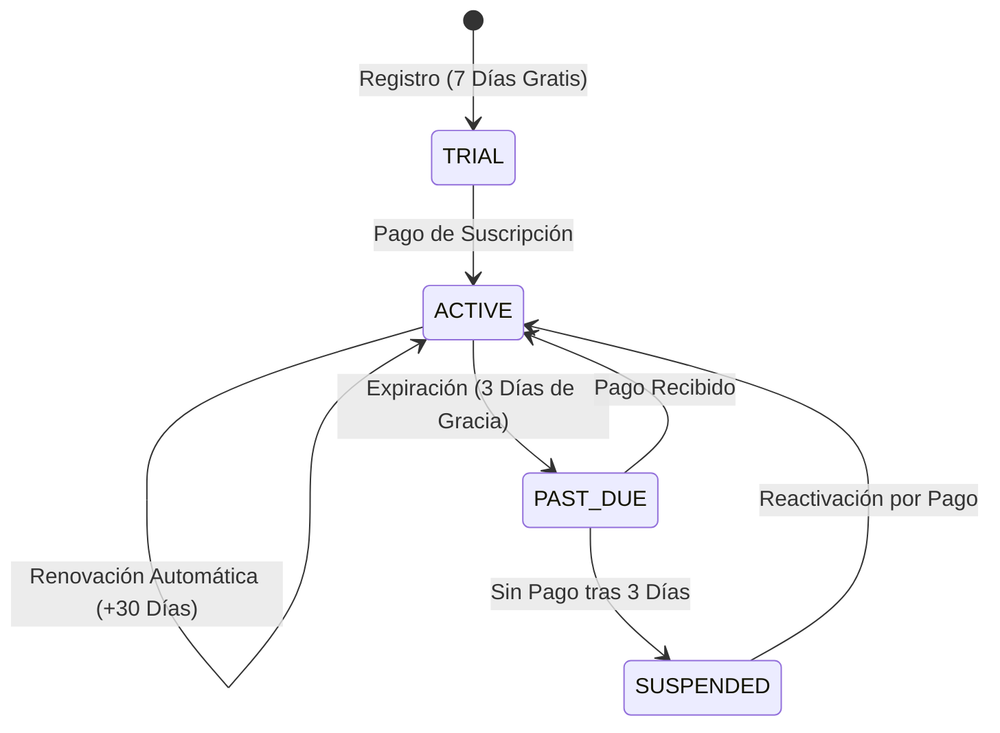

# 🌟 FIRBY SAAS MASTER SPECIFICATION (2026+)
## *El Sistema Operativo Autónomo de Negocios y Fuerza Laboral Digital*

---

## 📑 TABLA DE CONTENIDOS
1. [Visión y Posicionamiento de Mercado](#1-visión-y-posicionamiento-de-mercado)
2. [Los 5 Empleados Digitales Autónomos](#2-los-5-empleados-digitales-autónomos)
3. [Modelo de Membresía SaaS & Tiers de Precios](#3-modelo-de-membresía-saas--tiers-de-precios)
4. [Ciclo de Vida de Suscripción & Periodos de Gracia](#4-ciclo-de-vida-de-suscripción--periodos-de-gracia)
5. [Experiencia Conversacional del Dueño (Cero Comandos)](#5-experiencia-conversacional-del-dueño-cero-comandos)
6. [Arquitectura Técnica & Multi-Tenancy](#6-arquitectura-técnica--multi-tenancy)
7. [Motor de Pagos Wompi (PSE/Nequi) & Stripe](#7-motor-de-pagos-wompi-psenequi--stripe)
8. [Triaje Médico de Emergencia & Código Rojo](#8-triaje-médico-de-emergencia--código-rojo)
9. [Motor de Growth & Reactivación Anti-Baneo](#9-motor-de-growth--reactivación-anti-baneo)
10. [Endpoints REST API del SaaS](#10-endpoints-rest-api-del-saas)
11. [Runbook de Operación & Despliegue en Servidor](#11-runbook-de-operación--despliegue-en-servidor)

---

## 1. VISIÓN Y POSICIONAMIENTO DE MERCADO

### 🎯 La Tesis Central:
Los negocios (clínicas, consultorios, spas, despachos, academias) **no quieren otro software ni otro chatbot de menú**. Quieren **resolver la carga operativa de contratar, entrenar y supervisar empleados para tareas repetitivas 24/7**.

Firby no se vende como software. **Firby se vende como una Agencia de Empleados Digitales de Alto Rendimiento** que atienden llamadas en vivo con voz humana indistinguible, responden WhatsApp en segundos, agendan citas, manejan objeciones de ventas, cobran anticipos y crean automatizaciones.

```
┌────────────────────────────────────────────────────────────────────────┐
│                      🧠 FIRBY CORE PLATFORM                            │
│                                                                        │
│   👩‍⚕️ Valeria        💼 Santiago       🎧 Camila         ⚙️ Nova        📢 Mateo    │
│  (Recepción/Voz)   (Ventas/Cobro)   (Soporte/Triaje)  (Workflows n8n)  (Growth)   │
└────────────────────────────────────────────────────────────────────────┘
```

---

## 2. LOS 5 EMPLEADOS DIGITALES AUTÓNOMOS

Cada cliente de Firby puede tener activos los siguientes 5 roles simultáneamente:

### 👩‍⚕️ 1. Valeria — Recepcionista & Front-Desk
* **Canales**: WhatsApp + Llamadas Telefónicas en Vivo (Voz humana con ElevenLabs Flash v2.5 / Deepgram Nova-3).
* **Funciones**:
  * Contesta en <3 segundos 24/7.
  * Consulta disponibilidad en Google Calendar en tiempo real.
  * Agenda citas médicas o comerciales.
  * Envía **recordatorios automáticos**:
    * **24 horas antes**: Detalle de fecha, hora y requisitos.
    * **2 horas antes**: Recordatorio final con link a Google Maps.
    * **24 horas después**: Seguimiento post-atención.

### 💼 2. Santiago — Closer de Ventas & Pagos
* **Canales**: WhatsApp.
* **Funciones**:
  * Calificación automática de prospectos (urgencia, presupuesto, tratamiento deseado).
  * **Matriz Psicológica de Objeciones**:
    * *Precio*: Desglose de valor, financiamiento y consulta diagnóstica.
    * *Tiempo/Duda*: Bloqueo tentativo de cupo por 48 horas sin compromiso.
    * *Confianza*: Presentación de credenciales médicas y casos de éxito.
  * Generación y envío de **Links de Pago (Wompi PSE / Nequi / Bancolombia / Stripe)**.

### 🎧 3. Camila — Soporte & Base de Conocimiento
* **Canales**: WhatsApp.
* **Funciones**:
  * Lee y consulta documentos PDF de la clínica (precios, consentimientos, post-operatorio).
  * Resuelve preguntas complejas sin alucinar dosis ni indicaciones médicas no autorizadas.
  * **Detector de Urgencias y Código Rojo**: Si detecta dolor agudo, hemorragia o fiebre, interrumpe el flujo y dispara una alerta sonada en <2 seg al Telegram del doctor.

### ⚙️ 4. Nova — Creador de Automatizaciones
* **Canales**: WhatsApp / Panel Admin.
* **Funciones**:
  * Traduce órdenes del dueño en lenguaje natural a flujos ejecutables en **n8n local**.
  * Ej: *"Cada vez que alguien pague una cita, guarda los datos en Google Sheets y mándale un correo al doctor"*.

### 📢 5. Mateo — Growth & Reactivación
* **Canales**: WhatsApp Saliente.
* **Funciones**:
  * Identifica pacientes que llevan >60 o >90 días sin volver.
  * Ejecuta campañas hiperpersonalizadas de reactivación.
  * **Cola de seguridad Anti-Baneo**: Aplica retrasos aleatorios de 90 a 180 segundos entre contactos.

---

## 3. MODELO DE MEMBRESÍA SAAS & TIERS DE PRECIOS



| Característica | 📦 Starter | 🚀 Pro | 👑 Enterprise |
| :--- | :---: | :---: | :---: |
| **Precio Mensual (COP)** | **$299.000** | **$690.000** | **$1.490.000** |
| **Precio Mensual (USD)** | **$75** | **$175** | **$375** |
| **Atención WhatsApp 24/7** | ✅ | ✅ | ✅ |
| **Google Calendar & Recordatorios** | ✅ | ✅ | ✅ |
| **Seguimiento Post-Cita (24h)** | ✅ | ✅ | ✅ |
| **Llamadas Telefónicas con Voz Humana (Vapi)** | ❌ | ✅ | ✅ |
| **Línea Telefónica Dedicada** | ❌ | ✅ | ✅ |
| **Closer de Ventas & Links de Pago (Wompi)** | ❌ | ✅ | ✅ |
| **Manejo de Objeciones Psicológicas** | ❌ | ✅ | ✅ |
| **Los 5 Empleados Digitales** | ❌ | ❌ | ✅ |
| **Creador de Automatizaciones por Chat (n8n)** | ❌ | ❌ | ✅ |
| **Campañas de Reactivación & Growth** | ❌ | ❌ | ✅ |
| **Triaje Médico & Alertas de Urgencia** | ❌ | ❌ | ✅ |
| **Margen Bruto Estimado** | **>95%** | **>85%** | **>85%** |

---

## 4. CICLO DE VIDA DE SUSCRIPCIÓN & PERIODOS DE GRACIA

Para garantizar la retención y una experiencia prémium, Firby implementa un ciclo de vida con protección contra cancelaciones abruptas:



### 🛡️ Estados de Membresía:
1. **TRIAL (7 días)**: Acceso completo a todas las funciones para enamorar al cliente.
2. **ACTIVE (Activa)**: Servicio 100% operativo en todas las líneas.
3. **PAST_DUE (Período de Gracia de 3 días)**:
   * El servicio **NO se corta de golpe**.
   * Firby le envía un mensaje cálido al dueño por WhatsApp:
     > *"Hola Doctor/a! Le recordamos que su membresía Pro de Firby vence en 3 días. Para mantener a su equipo de empleados digitales activo 24/7 sin interrupciones, puede renovar aquí: [Link de Pago]"*
4. **SUSPENDED (Pausado)**:
   * Si no renueva, el bot no se borra ni se pierde su base de datos.
   * Se pausa elegantemente y responde a nuevos pacientes con un mensaje de fuera de horario.

---

## 5. EXPERIENCIA CONVERSACIONAL DEL DUEÑO (CERO COMANDOS)

El dueño de la clínica **nunca usa comandos de barra (`/`) ni interfaces complejas**. Se comunica con Firby en español cotidiano por texto o notas de voz:

| Lo que dice el Dueño | Acción que ejecuta Firby |
| :--- | :--- |
| *"Hola Valeria, cómo estuvo el día hoy?"* | Resumen ejecutivo: personas atendidas, citas agendadas y depósitos. |
| *"Qué citas tenemos para mañana?"* | Lista la agenda médica con horarios y tratamientos. |
| *"Pausa a Santiago un momento que le voy a hablar yo"* | Silencia el bot exclusivamente para ese número. |
| *"Ya puedes volver a hablar con Santiago"* | Reactiva la atención automática para ese paciente. |
| *"Créame un flujo que cuando alguien pague me avise al correo"* | Construye la automatización en n8n y reporta el ID en vivo. |
| *"Mándale un mensaje a los pacientes viejos"* | Inicia la campaña segura de reactivación con pausas anti-spam. |
| *"Quiénes están trabajando en mi bot?"* | Despliega los empleados digitales activos y sus funciones. |

---

## 6. ARQUITECTURA TÉCNICA & MULTI-TENANCY

El stack está optimizado para ejecutarse en el servidor **Ubuntu 24.04** con aislamiento completo por cliente:

```
/home/ubuntu/firby/
├── instances/
│   ├── clinica-de-las-americas/   --> Puerto 8003 (SQLite aislado + .env)
│   ├── cliente-2/                 --> Puerto 8004
│   └── cliente-n/                 --> Puerto 800n
├── src/
│   ├── firby/
│   │   ├── brain/                 --> Motores de IA, Ventas, Triaje, Growth
│   │   ├── voice/                 --> Telefonía Vapi & Twilio
│   │   ├── integrations/          --> Wompi, Google Calendar, Stripe
│   │   └── core/                  --> Membresías, Roles, Tareas
│   └── interfaces/web/            --> FastAPI Web & Webhooks
```

---

## 7. MOTOR DE PAGOS WOMPI (PSE/NEQUI) & STRIPE

* **Archivo**: [`src/firby/integrations/payments.py`](file:///home/ubuntu/firby/src/firby/integrations/payments.py)
* **Pasarelas Soportadas**:
  * **Wompi** (Bancolombia, Nequi, PSE, Tarjetas de Crédito en Colombia).
  * **Bold.co** (Tarjetas y PSE).
  * **Stripe** (Tarjetas internacionales / USD).
* **Flujo**:
  1. Paciente pre-agenda cita.
  2. Santiago genera link único con monto de anticipo.
  3. Paciente paga en Wompi.
  4. Webhook `/api/saas/webhook/wompi` confirma el pago y blinda la cita.

---

## 8. TRIAJE MÉDICO DE EMERGENCIA & CÓDIGO ROJO

* **Archivo**: [`src/firby/brain/knowledge_triage.py`](file:///home/ubuntu/firby/src/firby/brain/knowledge_triage.py)
* **Patrones Detectados**: *Sangrado profuso, dolor insoportable, fiebre post-quirúrgica, problemas respiratorios, puntos sueltos*.
* **Protocolo**:
  1. Interrupción del bot comercial.
  2. Respuesta tranquilizadora con primeros auxilios al paciente.
  3. **Alerta sonada prioritaria a Telegram del doctor en <2 segundos**.

---

## 9. MOTOR DE GROWTH & REACTIVACIÓN ANTI-BANEO

* **Archivo**: [`src/firby/brain/growth_engine.py`](file:///home/ubuntu/firby/src/firby/brain/growth_engine.py)
* **Algoritmo**:
  * Selecciona pacientes con última visita >60 o >90 días.
  * Genera saludo cálido personalizado con su nombre y último tratamiento.
  * **Pausa aleatoria de 90 a 180 segundos entre envíos** (imposible de detectar como spam por WhatsApp).

---

## 10. ENDPOINTS REST API DEL SAAS

| Método | Endpoint | Descripción |
| :--- | :--- | :--- |
| `GET` | `/api/saas/plans` | Retorna los 3 planes de membresía con precios y características. |
| `GET` | `/api/saas/status?tenant_id=xxx` | Consulta el estado y días restantes de la membresía. |
| `POST` | `/api/saas/checkout` | Genera el link de pago/suscripción Wompi/Stripe. |
| `POST` | `/api/saas/webhook/wompi` | Webhook de confirmación automática de pagos. |
| `POST` | `/api/voice/vapi/webhook` | Webhook de telefonía en vivo y agendamiento por voz. |

---

## 11. RUNBOOK DE OPERACIÓN & COMANDOS CLI

```bash
# Ver estado de todas las instancias y membresías
firby list

# Consultar membresía SaaS de un cliente
firby saas clinica-de-las-americas

# Crear una nueva instancia para un cliente nuevo en 10 segundos
firby new

# Ver logs en tiempo real con diagnóstico automático
firby logs clinica-de-las-americas

# Reiniciar todos los procesos de forma limpia
pm2 restart all --update-env
```
