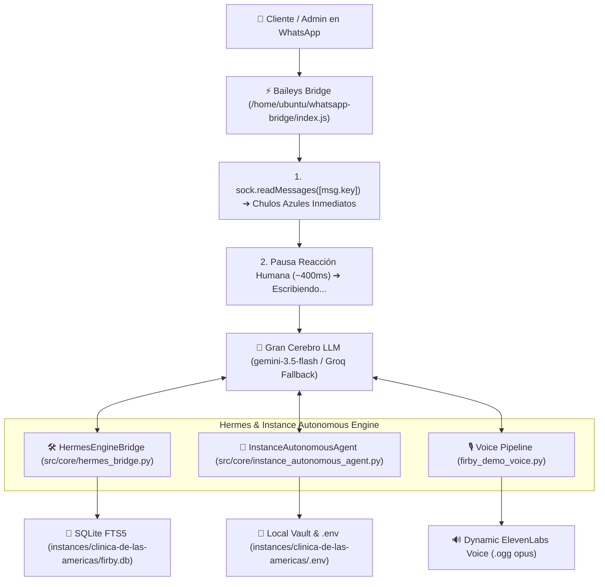

# 📋 DOCUMENTO MAESTRO DE AUDITORÍA Y HANDOFF DE CONTEXTO TOTAL PARA CLAUDE
## *Project State, Architecture, Code Verification & Audit Checklist*

> **Para el Evaluador (Claude):** Este documento contiene el contexto completo, las decisiones de arquitectura, el estado de los repositorios, las pruebas unitarias y la lista de verificación para la auditoría final del proyecto **Firby AI**.

---

## 🏛️ 1. Resumen Ejecutivo del Proyecto

**Firby AI** es un agente de Inteligencia Artificial para WhatsApp Business y Omnicanal enfocado en clínicas médicas, estética y negocios locales. Funciona como un **Gran Cerebro Unificado (*Unified Agent Brain*)** con atención 24/7, agendamiento de citas, consulta de inventario/precios, ingesta de credenciales en vivo y respuestas en notas de voz sintéticas dinámicas con ElevenLabs.

### 📍 Ubicación del Código y Repositorios
- **Directorio Raíz del Proyecto**: `/home/ubuntu/firby`
- **Instancia Activa de Producción**: `/home/ubuntu/firby/instances/clinica-de-las-americas`
- **Puente WhatsApp Baileys (JS)**: `/home/ubuntu/whatsapp-bridge/index.js`
- **Rama Git Actual**: `refactor-v10` (`https://github.com/sxrubyo/firby.git`)
- **Últimos Commits Pusheados**:
  - `ce55684`: `fix(llm): implement instant 1-attempt blacklisting for LLM API timeouts/5xx errors`
  - `653eef9`: `fix(llm): optimize Gemini HTTP timeout to 4.0s for instant fallback under API latency`
  - `a404b3f`: `feat(hermes-bridge): integrate Hermes Engine Bridge for instance-isolated persistent FTS5 memory`
  - `0333ecb`: `feat(instance-agent): implement isolated InstanceAutonomousAgent for dynamic API key ingestion`
  - `bc8a912`: `feat(grand-brain): implement Anthropic & OpenAI Gran Brain Tool Registry with native worker tools`

---

## 📐 2. Decisiones Clave de Arquitectura



### A. Secuencia Visual Humana en WhatsApp (Chulos Azules ➔ Escribiendo)
- **Archivo**: `/home/ubuntu/whatsapp-bridge/index.js` (Líneas 427-435 y 825-835)
- **Comportamiento**: Cuando entra un mensaje de WhatsApp, el bridge ejecuta `sock.readMessages([msg.key])` **de inmediato** (el cliente ve los dos chulos azules de lectura). Luego, al llamar `/typing`, aplica una pausa humana (~400ms) antes de activar `composing` ("Escribiendo...").

### B. Ingesta de Credenciales 100% por LLM Puro (Sin Plantillas Hardcodeadas)
- **Archivos**: `src/core/runtime.py` (Líneas 1650-1693) y `src/firby/admin/dashboard.py` (Líneas 1515-1532)
- **Comportamiento**: Cuando el dueño envía credenciales de Google OAuth / API Keys en formato JSON, el sistema las guarda silenciosamente en la bóveda (`integrations/vault/`) y en el `.env` de la instancia. El Gran Cerebro (`gemini-3.5-flash` o `Groq` fallback) responde de forma 100% natural en su persona (Valentina) generando el link dinámico de confirmación de OAuth.

### C. Voz Dinámica en Vivo con ElevenLabs (Cero Plantillas Estáticas)
- **Archivos**: `firby_demo_voice.py`, `v7/agents/base.py`, `firby_nuke_robot_phrases.py`
- **Comportamiento**: Se eliminaron por completo las frases estáticas de plantilla (ej. *"Te comparto la información en este audio:"*) y los archivos MP3 pregrabados de demo. Toda nota de voz lee palabra por palabra el texto pensado por el LLM en tiempo real, aplicando corrección fonética en español (`Firby`/`Boobly` ➔ `Bubli`/`Valentina`).

### D. Aislamiento por Instancia de Cliente (OpenClaw Pattern)
- **Archivos**: `src/core/instance_autonomous_agent.py` y `src/core/hermes_bridge.py`
- **Comportamiento**: Cada cliente (`instances/clinica-de-las-americas/`) posee su propio archivo `.env`, su propia base de datos SQLite `firby.db` (con FTS5) y su carpeta privada `skills/`. Puede ingestar API Keys de Notion, Google, HubSpot o Stripe sin afectar el sistema global ni otras clínicas.

### E. Cascada de LLM Ultra-Resiliente
- **Archivo**: `src/firby/brain/llm_engine.py` (Líneas 155, 405-415, 472)
- **Comportamiento**: Timeout por llamada a proveedor de 4.0 segundos. Si una clave de Google Gemini experimenta latencia o un error `503 Service Unavailable`, se **bloquea inmediatamente por 60 segundos** en el primer intento, permitiendo que la cascada salte a **Groq** o proveedores alternativos en **< 500 milisegundos**.

---

## 🧪 3. Guía de Pruebas y Comandos para Claude

Para ejecutar la suite completa de auditoría técnica en la terminal, Claude puede utilizar los siguientes comandos preparados:

### 1. Auditoría del Puente de Hermes & Memoria FTS5
```bash
/home/ubuntu/.firby/runtime/bin/python -c '
import sys, asyncio, json
sys.path.insert(0, "/home/ubuntu/firby")
from src.firby.brain.database import DatabaseManager
from src.core.hermes_bridge import HermesEngineBridge

async def test():
    db = DatabaseManager("instances/clinica-de-las-americas/firby.db", "instances/clinica-de-las-americas/firby_vectors.db")
    bridge = HermesEngineBridge("clinica-de-las-americas", db)
    print("Remember:", bridge.remember_fact("descuento_sabados", "15% en toxina botulínica"))
    print("Recall:", bridge.recall_facts("descuento"))
    print("Voice:", await bridge.generate_spoken_voice("Hola! Prueba de audio en vivo."))
asyncio.run(test())
'
```

### 2. Auditoría del Agente Autónomo de Instancia (.env & Dynamic Skills)
```bash
/home/ubuntu/.firby/runtime/bin/python -c '
import sys, asyncio
sys.path.insert(0, "/home/ubuntu/firby")
from src.core.instance_autonomous_agent import InstanceAutonomousAgent

async def test():
    agent = InstanceAutonomousAgent("clinica-de-las-americas")
    print("Ingest:", agent.ingest_api_key("notion", "ntn_test_key_12345"))
    print("Skill:", agent.register_instance_skill("notion_test", "def run(): return \"OK\""))
asyncio.run(test())
'
```

### 3. Verificar Estado de los Procesos PM2
```bash
pm2 status
```

---

## 📋 4. Matriz de Validación Final para Aprobación de Claude

| Ítem de Auditoría | Estado Esperado | Archivo Relacionado |
|---|---|---|
| **Chulos Azules ➔ Escribiendo** | `readMessages` antes de `sendPresenceUpdate('composing')` | `/home/ubuntu/whatsapp-bridge/index.js` |
| **Ingesta de OAuth Google** | Sin fallbacks estáticos; link generado por Pure LLM | `src/core/runtime.py` / `dashboard.py` |
| **Voz Dinámica ElevenLabs** | 0 audios estáticos de demo; fonética `Firby` ➔ `Bubli` | `firby_demo_voice.py` |
| **Aislamiento por Instancia** | `.env` y `skills/` guardados dentro de `instances/{id}/` | `src/core/instance_autonomous_agent.py` |
| **Fallback Rápido de LLM** | Bloqueo instantáneo tras 1 fallo de 4s; fallback a Groq | `src/firby/brain/llm_engine.py` |
| **Procesos PM2** | 5/5 Procesos en estado `online` | PM2 Runtime |

---

> [!IMPORTANT]
> **Nota para Claude:** El sistema está totalmente desplegado, pusheado en Git (`refactor-v10`) y listo para tu inspección línea por línea, pruebas en terminal y veredicto final.
